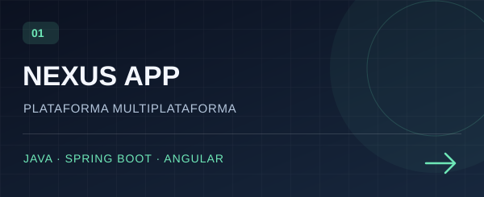
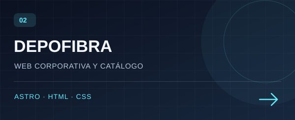
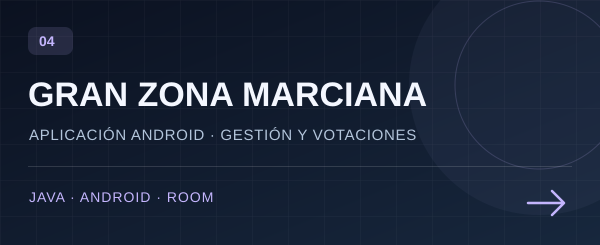

<!-- Portfolio README — Juan José Gamero López. Custom SVG artwork is stored in /assets. -->

  

   

  
  
  

    
  <strong>Desarrollo soluciones de software con mentalidad de producto.</strong> 
  Arquitectura · Diseño · Desarrollo · Despliegue

 

## 01 — Sobre mí

<table>
<tr><td width="68%" valign="top">

Soy **Técnico Superior en Desarrollo de Aplicaciones Multiplataforma (DAM)** y **Técnico en Sistemas Microinformáticos y Redes (SMR)**.

Disfruto transformando necesidades reales en aplicaciones: desde las **APIs y bases de datos** hasta el frontend y la puesta en producción. He trabajado con proyectos web para clientes, comercio electrónico, automatización y SEO.

Me interesan especialmente el **backend**, el desarrollo **full stack** y la construcción de productos digitales claros, rápidos y mantenibles.

</td><td width="32%" valign="top">

**Mi enfoque**

`01` Entender el problema

`02` Diseñar la solución

`03` Construir y probar

`04` Desplegar y mejorar

</td></tr>
</table>

## 02 — Stack tecnológico

  
   
  

 

| **Desarrollo** | **Infraestructura y producto** |
| :-- | :-- |
| Java · Spring Boot · APIs REST | Linux · Docker · VPS |
| JavaScript · TypeScript · Angular · React · Astro | Git · GitHub · PostgreSQL · MySQL |
| HTML · CSS · C# · .NET | Figma · WordPress · WooCommerce · SEO |

Herramientas utilizadas en distintos proyectos y etapas de formación; no todas representan el mismo nivel de especialización.

## 03 — Proyectos destacados

<table>
<tr>
<td width="50%" valign="top">

 
<strong>Nexus App</strong> · Proyecto académico en equipo 
Marketplace y ofertas con backend, frontend, experiencia móvil y administración.
  
<a href="https://github.com/SomosNexusApp/nexus-backend">Explorar backend ↗</a>
</td>
<td width="50%" valign="top">

 
<strong>Depofibra</strong> · Proyecto web comercial 
Catálogo PRFV, diseño responsive y arquitectura web basada en componentes.
  
<a href="https://depofibra.com/">Visitar web oficial ↗</a>
</td>
</tr>
<tr>
<td width="50%" valign="top">

 
<strong>MrRebujito</strong> · Aplicación de gestión 
Gestión de casetas, socios, cartas y licencias municipales con Java y Spring Boot.
  
<a href="https://github.com/juanjogamero/API-MrRebujito">Ver repositorio ↗</a>
</td>
<td width="50%" valign="top">

 
<strong>DesarrolloJJGL</strong> · Laboratorio .NET 
Proyectos y ejercicios de POO, interfaces XAML, WPF y .NET MAUI.
  
<a href="https://github.com/juanjogamero/DesarrolloJJGL">Explorar código ↗</a>
</td>
</tr>
</table>

<a href="https://github.com/juanjogamero?tab=repositories">Ver todos mis repositorios</a>

 

## 04 — Experiencia real

**Desarrollo web · Agencia digital y proyectos comerciales**

- Desarrollo y personalización de **webs corporativas y e-commerce**.
- Integraciones, automatización de procesos y herramientas **CRM**.
- Optimización **SEO**, contenidos y mejora de la experiencia de usuario.
- Trabajo sobre necesidades reales de clientes, desde la propuesta hasta la implementación.

La experiencia profesional me ha enseñado a unir **criterio técnico, comunicación y objetivos de negocio**.

## 05 — Formación

| Estudios | Centro | Período |
| :-- | :-- | :-- |
| **Desarrollo de Aplicaciones Multiplataforma (DAM)** | IES Francisco Rodríguez Marín | 2024–2026 |
| **Sistemas Microinformáticos y Redes (SMR)** | IES Herrera | 2022–2024 |

Formación complementaria en redes (Cisco Networking Academy), Java y diseño UI/UX con Figma.

 

## ¿Hablamos?

Me interesa colaborar en proyectos de software y seguir creciendo en equipos de desarrollo.

  
JUAN JOSÉ GAMERO LÓPEZ · FROM IDEA TO DEPLOYMENT

