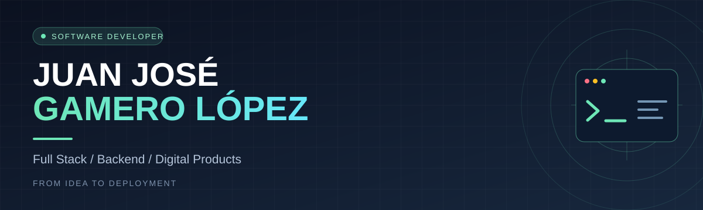
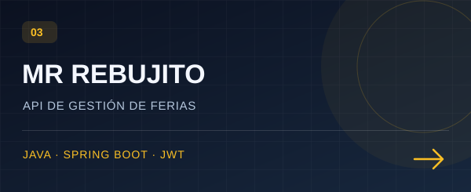

<!--
  GitHub Profile README | Juan José Gamero López
  Recursos visuales originales en ./assets/. Sin emojis ni estadísticas ficticias.
  Para visualizarlo en el perfil de GitHub, crea un repositorio público
  que tenga exactamente el mismo nombre que tu usuario de GitHub.
-->

  
    
  
  
  

 

## 01 / Sobre mí

Soy **desarrollador de software y técnico superior en Desarrollo de Aplicaciones Multiplataforma (DAM)**, con formación previa en **Sistemas Microinformáticos y Redes (SMR)**.

Me interesa crear soluciones completas: desde el diseño de una API y el modelado de datos hasta una interfaz bien pensada y su despliegue. Combino la base técnica de **Java, Spring Boot y Angular** con conocimientos de infraestructura, contenedores y diseño de producto.

Mi experiencia en agencia también me ha permitido trabajar con **proyectos y necesidades reales de clientes**, comercio electrónico, automatizaciones y optimización de procesos digitales.

<table>
  <tr>
    <td width="33%" align="center"><strong>12 meses</strong> Experiencia en agencia</td>
    <td width="33%" align="center"><strong>DAM + SMR</strong> Software, sistemas y redes</td>
    <td width="33%" align="center"><strong>End-to-end</strong> Diseño · Desarrollo · Despliegue</td>
  </tr>
</table>

## 02 / Tecnologías

**Stack principal** · tecnologías con las que he construido soluciones web y multiplataforma.

  

**Otras herramientas y experiencia transversal** · frontend, móvil, datos y diseño.

  

También: APIs REST · Hibernate · WebSockets · JWT · Android nativo · WooCommerce · Proxmox · Windows Server.

## 03 / Proyectos seleccionados

### Nexus App · Plataforma multiplataforma

Proyecto académico desarrollado **en equipo**: un ecosistema de marketplace y búsqueda de ofertas con aplicación web, experiencia móvil Android, API backend y panel de administración.

**Aspectos técnicos destacados:** arquitectura desacoplada, autenticación con JWT y 2FA, integración de pagos con Stripe, chat mediante WebSockets (STOMP), PostgreSQL, Docker y despliegue en servicios cloud.

[Backend / Spring Boot](https://github.com/SomosNexusApp/nexus-backend) &nbsp;·&nbsp; [Web y móvil / Angular](https://github.com/SomosNexusApp/nexus-angular-app) &nbsp;·&nbsp; [Panel de administración](https://github.com/SomosNexusApp/nexus-admin-web-app) &nbsp;·&nbsp; [Documentación](https://github.com/SomosNexusApp/nexus-web-about)

 

<table>
  <tr>
    <td width="50%" valign="top">
      
      
<strong>MrRebujito</strong>

      
Proyecto de aplicación web con backend en <strong>Java / Spring Boot</strong>, interfaz adaptable y trabajo de identidad visual y UI/UX.

    </td>
    <td width="50%" valign="top">
      
      
<strong>LePokedex</strong>

      
Aplicación nativa para Android desarrollada con <strong>Java y Android Studio</strong>, navegación entre pantallas y componentes dinámicos en XML.

    </td>
  </tr>
</table>

La documentación de MrRebujito y LePokedex figura en mi perfil de LinkedIn; aquí no incluyo enlaces a repositorios que no he podido verificar como públicos.

## 04 / Experiencia y enfoque

**Linkealia · Agencia de comunicación** — Trabajando actualmente como Full Stack Developer

- Desarrollo, personalización y maquetación de webs corporativas y tiendas online con **WordPress y WooCommerce**.
- Integración de pasarelas de pago, personalizaciones técnicas y mejora de flujos de conversión.
- Automatizaciones y gestión de CRM, especialmente **Clientify**.
- Trabajo con **SEO on-page, GEO, contenidos digitales y Google Ads**.

**También me interesa el diseño de producto.** En proyectos como **unESPACIO** he trabajado la identidad visual, el sistema gráfico y el diseño de packaging: una perspectiva que me ayuda a conectar el código con la experiencia del usuario.

## 05 / Formación

| Formación | Centro | Período |
| :-- | :-- | :-- |
| **Técnico Superior en Desarrollo de Aplicaciones Multiplataforma** | IES Francisco Rodríguez Marín | 2024–2026 |
| **Técnico en Sistemas Microinformáticos y Redes** | IES Herrera | 2022–2024 |

**Formación complementaria:** Fundamentos de Redes (Cisco Networking Academy), Java y diseño UI/UX con Figma (OpenWebinars).

## 06 / Contacto

Me interesa seguir creciendo en **desarrollo full stack y backend**, participar en proyectos con retos reales y colaborar con equipos que valoren tanto el código como la calidad del producto.

**[LinkedIn](https://www.linkedin.com/in/juan-jos%C3%A9-gamero-l%C3%B3pez-76326b27a/)** &nbsp; / &nbsp; **[Correo electrónico](mailto:juanjosegamerolopez@gmail.com)**

  

